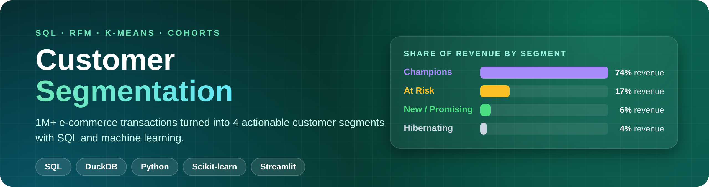
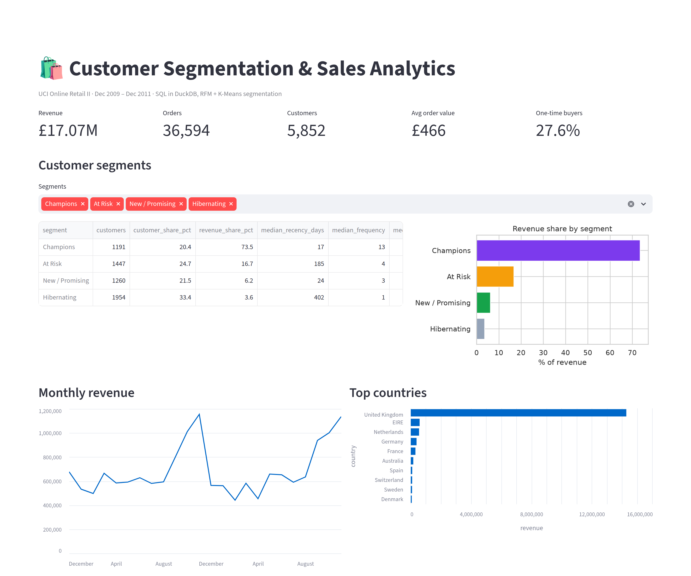
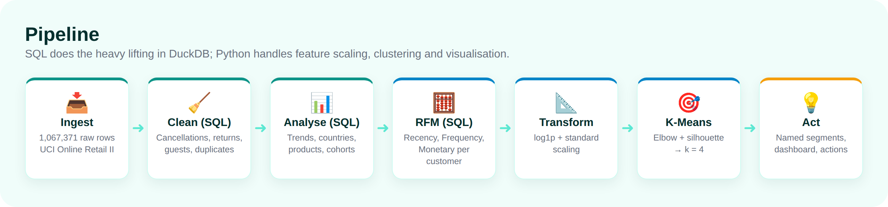
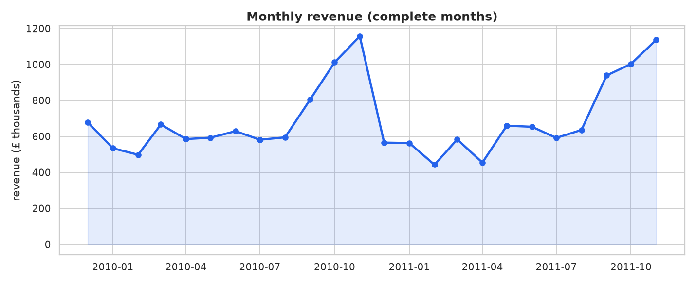
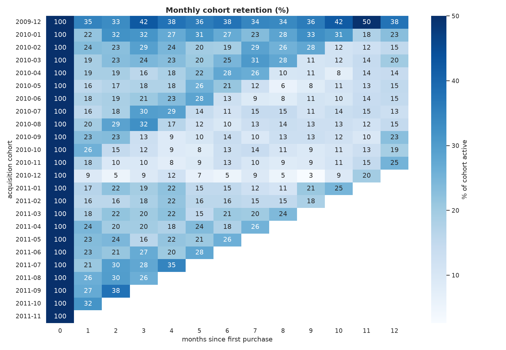
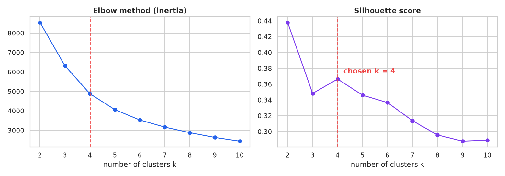
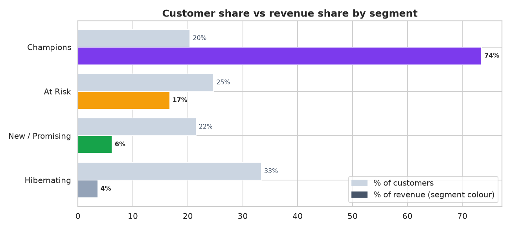
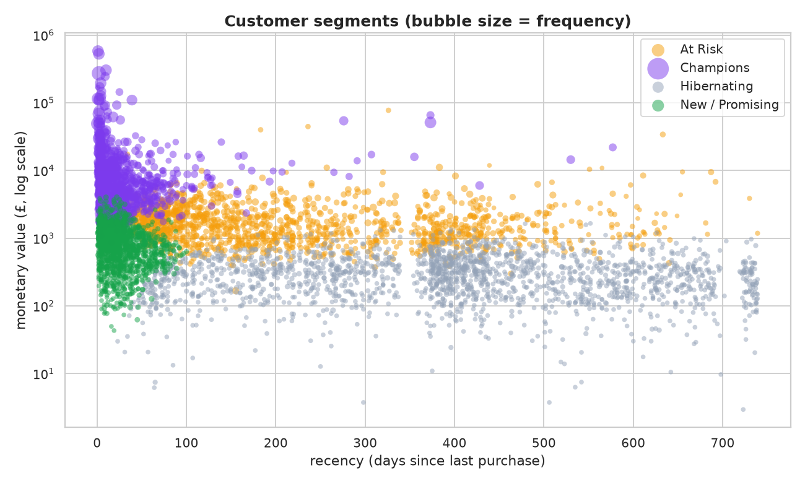

<p align="center">
  
</p>

<p align="center">
  
  
  
  
  
</p>

<p align="center">
  <b>End-to-end customer analytics on 1M+ real e-commerce transactions: SQL data cleaning and analysis,<br>cohort retention, RFM feature engineering and K-Means segmentation, turned into business actions.</b>
</p>

---

## 📈 Results at a glance

<table align="center">
  <tr>
    <td align="center"><h2>£17.07M</h2>revenue analysed</td>
    <td align="center"><h2>5,852</h2>customers segmented</td>
    <td align="center"><h2>20%</h2>of customers (Champions)</td>
    <td align="center"><h2>74%</h2>of revenue from them</td>
    <td align="center"><h2>20.7%</h2>avg month-1 retention</td>
  </tr>
</table>

## ✨ Highlights

| | |
|---|---|
| 🧹 **SQL data cleaning** | Removes cancellations, returns, zero-price rows, guest checkouts, non-product codes and 34,335 duplicate rows: **1,067,371 → 776,577** clean rows. |
| 🧮 **Advanced SQL** | CTEs and window functions (`LAG`, `RANK`, `FIRST_VALUE`, running `SUM() OVER`, `QUALIFY`) for trends, rankings and cohort retention. |
| 📅 **Cohort analysis** | Monthly acquisition cohorts show how many customers come back 1–12 months after their first purchase. |
| 🧠 **RFM + K-Means** | Recency/Frequency/Monetary features, log-transformed and scaled; k chosen with the elbow method + silhouette score. |
| 🏷️ **Explainable segments** | Clusters are named by rules on their median RFM values (not by hand), each with a concrete marketing action. |
| 📊 **Interactive dashboard** | Streamlit app with KPIs, segment explorer, revenue trend and cohort heatmap. |
| ✅ **Tested** | Pytest checks every SQL cleaning rule, the RFM maths and the cohort logic on hand-built edge cases. |

## 🎬 Dashboard

<p align="center">
  
</p>

## 🔬 Pipeline

<p align="center">
  
</p>

## 🧮 SQL showcase

Cohort retention with window functions ([`sql/06_cohort_retention.sql`](sql/06_cohort_retention.sql)):

```sql
WITH customer_months AS (
    SELECT DISTINCT customer_id, date_trunc('month', invoice_date) AS order_month
    FROM sales
    WHERE invoice_date < (SELECT date_trunc('month', MAX(invoice_date)) FROM sales)  -- drop partial month
),
with_cohort AS (
    SELECT customer_id, order_month,
           MIN(order_month) OVER (PARTITION BY customer_id) AS cohort_month
    FROM customer_months
),
cohort_counts AS (
    SELECT cohort_month,
           datediff('month', cohort_month, order_month) AS month_number,
           COUNT(*) AS active_customers
    FROM with_cohort
    GROUP BY 1, 2
)
SELECT cohort_month, month_number, active_customers,
       ROUND(100.0 * active_customers
             / FIRST_VALUE(active_customers) OVER (PARTITION BY cohort_month ORDER BY month_number), 1) AS retention_pct
FROM cohort_counts
ORDER BY cohort_month, month_number;
```

Month-over-month growth with `LAG` ([`sql/03_monthly_revenue.sql`](sql/03_monthly_revenue.sql)):

```sql
ROUND(100.0 * (revenue / LAG(revenue) OVER (ORDER BY month) - 1), 1) AS revenue_mom_pct
```

| File | What it answers |
|------|-----------------|
| `01_clean.sql` | Builds the clean `sales` table (5 documented rules) |
| `02_data_quality.sql` | How many rows each rule affects |
| `03_monthly_revenue.sql` | Revenue, orders, active customers, AOV and MoM growth per month |
| `04_top_products.sql` | Top 15 products and their revenue share (`RANK`, `QUALIFY`) |
| `05_top_countries.sql` | Revenue by country with cumulative share |
| `06_cohort_retention.sql` | Monthly cohort retention matrix |
| `07_rfm.sql` | Recency, frequency and monetary value per customer |

## 🔍 Key findings

**Sales.** £17.07M revenue from 36,594 orders (average order value £466). Revenue peaks every November (£1.16M in Nov 2010, £1.14M in Nov 2011): it's a gift retailer stocking up for Christmas. The UK brings in **83.7%** of revenue, and the top 3 countries bring in 90.4%.

<p align="center"></p>

**Retention.** On average only **20.7%** of a new cohort buys again the next month, and **27.6%** of customers only ever ordered once. The Dec 2009 cohort retains much better (35% in month 1) because the data starts that month, so it also contains long-standing customers.

<p align="center"></p>

**Segmentation.** Frequency and monetary value are extremely skewed (skewness 12.0 and 25.3), so they are log-transformed before scaling (skewness after: 1.0 and 0.3). k = 2 has the highest silhouette (0.438) but only separates "good" from "bad" customers; among k ≥ 3, **k = 4** scores best (0.366) and sits at the elbow.

<p align="center"></p>

| Segment | Customers | Median recency | Median orders | Median spend | % of revenue | Recommended action |
|---------|----------:|---------------:|--------------:|-------------:|-------------:|--------------------|
| 🟣 **Champions** | 1,191 (20.4%) | 17 days | 13 | £4,890 | **73.5%** | VIP/loyalty perks, early access, referrals; avoid unnecessary discounts |
| 🟠 **At Risk** | 1,447 (24.7%) | 185 days | 4 | £1,450 | 16.7% | Personalised win-back campaign now; high past value justifies spend |
| 🟢 **New / Promising** | 1,260 (21.5%) | 24 days | 3 | £717 | 6.2% | Onboarding journey and second-order incentive to build the habit |
| ⚪ **Hibernating** | 1,954 (33.4%) | 402 days | 1 | £273 | 3.6% | Low-cost automated reactivation only |

<table>
  <tr>
    <td width="50%"></td>
    <td width="50%"></td>
  </tr>
</table>

## 🚀 Quick start

```bash
python -m venv .venv && source .venv/bin/activate
pip install -r requirements.txt

python -m src.pipeline      # downloads data (~45 MB), runs all SQL, segments customers, writes reports/
streamlit run app.py        # interactive dashboard
pytest -q                   # tests
jupyter notebook notebooks/analysis.ipynb
```

## 📁 Project structure

```
customer-segmentation-sql/
├── sql/                     # 7 documented DuckDB SQL files (cleaning → RFM)
├── src/
│   ├── download.py          # fetch UCI Online Retail II, cache as Parquet
│   ├── sql_runner.py        # run SQL files, save results to reports/sql/
│   ├── segment.py           # RFM scores, scaling, K-Means, segment naming
│   └── pipeline.py          # end-to-end run + charts
├── app.py                   # Streamlit dashboard
├── notebooks/analysis.ipynb # walkthrough with outputs
├── tests/                   # pytest: cleaning rules, RFM, cohorts
├── reports/                 # charts, CSV outputs, run log
└── INTERVIEW.md             # interview questions & answers about this project
```

## 🗺️ Roadmap

- [ ] Customer lifetime value (CLV) prediction (BG/NBD + Gamma-Gamma)
- [ ] Market basket analysis (association rules) for cross-sell recommendations
- [ ] Schedule the pipeline (Airflow / cron) and load segments into a CRM
- [ ] A/B test the win-back campaign for the At Risk segment

---

<sub>Data: <a href="https://archive.ics.uci.edu/dataset/502/online+retail+ii">UCI Online Retail II</a> by Daqing Chen, licensed CC BY 4.0.</sub>
